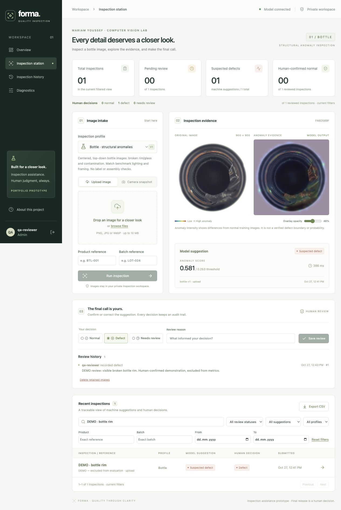

# Forma · Computer Vision Quality Inspection

An inspection-assistance project by **Mariam Youssef**, built with React,
TypeScript, FastAPI, OpenCV/NumPy and SQLAlchemy. SQLite supports local use;
Docker Compose provides PostgreSQL.

Inspect **centered, top-down bottle images** for structural anomalies and
contamination. Upload an image or capture a webcam snapshot, compare the original
with an anomaly map, record a human decision, search history and export CSV.



## Run locally

Requires Python 3.12, Node.js 22+ and pnpm 11.25.0.

```bash
python3.12 -m venv .venv
.venv/bin/python -m pip install -r requirements.lock
cd frontend
pnpm install --frozen-lockfile
pnpm build
cd ..
./scripts/start.sh
```

The startup script applies migrations, registers the included model and prompts
for a private administrator account. Open http://127.0.0.1:8000.
API documentation: http://127.0.0.1:8000/docs.

Create additional accounts:

```bash
.venv/bin/python scripts/manage.py user operator --role reviewer
.venv/bin/python scripts/manage.py user observer --role viewer
```

The fitted model and four demo images are included. The full dataset is needed
only to reproduce fitting and evaluation. Uploaded images and records remain in
ignored `data/` storage. See [operations](docs/OPERATIONS.md) for configuration,
HTTPS, backups and retention.

## Docker Compose

```bash
cp .env.example .env
# Set a private, URL-safe POSTGRES_PASSWORD in .env.
docker compose up --build -d
docker compose exec app python scripts/manage.py user mariam --role admin
```

Open http://127.0.0.1:8000. Named volumes preserve records and image files.
Docker/PostgreSQL execution remains unverified; local SQLite was tested.

## Reproduce and test

```bash
.venv/bin/python scripts/acquire_data.py
# Alternatively, import lawfully obtained data:
.venv/bin/python scripts/acquire_data.py --import-from /path/to/bottle
.venv/bin/python scripts/train.py
.venv/bin/python scripts/evaluate.py
.venv/bin/python -m pytest backend/tests -q
```

For frontend development, run `pnpm dev` inside `frontend/` while the backend is
running. `pnpm build` checks TypeScript and creates the production frontend.

## Model and measured results

A position-aware nearest-normal LAB/Sobel feature baseline learns from 167
normal bottle images. A separate set of 42 normal images calibrates the
threshold. Evaluation uses 79 held-out images: 60 defective and 19 normal.
Four filename-selected demo images are excluded from these results.

| Metric | Result |
|---|---:|
| Defect recall | 59/60 · 98.33% |
| Defect precision | 59/62 · 95.16% |
| Normal false-reject rate | 3/19 · 15.79% |
| Image AUROC | 0.98596 |
| Average precision | 0.99629 |
| Median preprocessing + inference | 6.73 ms |
| Median full localhost upload request | 42.84 ms |

Measured on an Apple M3 MacBook Air, 8 GB RAM, CPU only. The anomaly score is
not a probability, and the heatmap is not validated segmentation. Different
lighting, framing, bottle types and physical webcam use remain unvalidated.
Product release requires a human decision.

## Features

- Upload and manual webcam snapshots with image-quality warnings.
- Real fitted-model inference and adjustable anomaly-map overlays.
- Private image storage and administrator/reviewer/viewer authorization.
- Immutable machine results, append-only reviews and reviewer audit history.
- Search, filters, pagination and matching CSV export.
- Idempotent uploads, database migrations and restart-safe records.
- Authorized image deletion and versioned candidate-feedback export.

## Documentation

[Dataset and license](docs/DATASETS.md) · [Model card](docs/MODEL_CARD.md) ·
[Evaluation and failures](docs/EVALUATION.md) · [API](docs/API.md) ·
[Operations](docs/OPERATIONS.md) · [Limitations](docs/LIMITATIONS.md)

## License

Application source: MIT. MVTec images, derived evidence and the fitted model:
**CC BY-NC-SA 4.0, noncommercial use only**. Required dataset attribution is
retained in [NOTICE.md](NOTICE.md).
