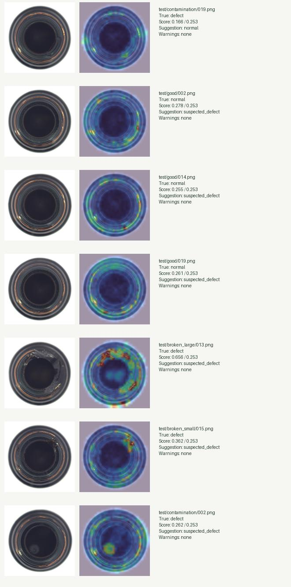

# Measured evaluation — 2026-10-27

## Protocol and hardware

Apple M3 MacBook Air, 8 CPU cores, 8 GB RAM, arm64 macOS 26.5.2, Python 3.12.14.
CPU-only evaluation of `bottle-v1`, a position-aware nearest-normal LAB/Sobel
feature baseline (see MODEL_CARD.md). No pretrained network is used.

167 normal fitting images, 42 disjoint normal validation images; seed 42. The
95th percentile (higher) normal validation threshold is **0.25250953435897827**.
No test images or masks were used for fitting, feature normalization or threshold
selection. Four first-by-filename test images were reserved for demonstrations
before evaluating and excluded. Final evaluation: **79 images**, 19 normal and
60 defective. These are not full official benchmark numbers or factory results.
The exact split and hashes are in `models/bottle-v1/config.json`, and all test
predictions/latencies are in `evaluation.json`.

## Results at the frozen scalar threshold

| Measure | Observed result |
|---|---:|
| True positives / false negatives | 59 / 1 |
| False positives / true negatives | 3 / 16 |
| Defect recall | 59/60 = **98.33%** |
| Defect precision | 59/62 = **95.16%** |
| Normal false-reject rate | 3/19 = **15.79%** |
| Image AUROC | **0.9859649** |
| Average precision | **0.9962866** |
| Broken-large recall | 19/19 |
| Broken-small recall | 21/21 |
| Contamination recall | 19/20 |

These binary metrics apply `score > threshold`. The UI adds abstentions for
scores in the [0.9×threshold, threshold] band or heuristic quality warnings. Its
three-way suggestions across the 79 images were 62 suspected defects, 15 normal,
and 2 needs review. Do not interpret these scores or AUROC as calibrated
confidence, and do not hide the 15.79% normal false-reject rate behind recall.
The calibration rule targets a training-normal quantile; it does not guarantee
that rate under test or deployment distribution shift.

No localization metric is reported: the output is a coarse anomaly map, not
validated segmentation. Official masks were decoded for integrity only.

## Latency

Measured per-image CPU wall clock on the above hardware:

| Stage | Median | p95 |
|---|---:|---:|
| Preprocessing only | 4.33 ms | 4.54 ms |
| Preprocessing + nearest-normal scoring + quality checks | 6.73 ms | 7.00 ms |
| Decode + preprocessing + inference | 17.11 ms | 18.00 ms |

These measurements exclude HTTP transfer, DB and evidence image encoding.
Ten actual localhost TCP upload requests (unique keys; all perform real inference,
evidence encoding, private file storage and database commits) measured a
**42.84 ms median**, with a maximum of 85.86 ms. See `http-latency.json`.
Cold requests include library initialization and can take longer than warm
requests. These timings apply to the measured hardware and workload.

## Actual failures and qualitative evidence

`test/contamination/019.png` was missed: score 0.166, below threshold, suggested
normal with no quality warning. The small interior anomaly did not produce a
strong top-cell distance. This is a concrete example of a dangerous false normal;
human inspection remains necessary.

Normal `test/good/002.png` (0.278), `014.png` (0.255), and `019.png` (0.261) were
flagged. The coarse maps emphasize rim/reflective appearance differences even
though the benchmark labels them normal. The last two are close to threshold.
The visual explanation is qualitative, not a verified causal diagnosis.

Each row shows original, 45% anomaly overlay, benchmark condition and actual
score/suggestion. Examples were selected after evaluation to explain failures;
they are not extra independent validation. Lighting, pose and arbitrary webcam
framing remain unvalidated domain shifts. Dark, blank and overexposed synthetic
fixtures verify abstention behavior only; they are not industrial accuracy data.

## Checks actually performed

- Successful acquisition and decoding of all 355 PNGs (including 63 masks),
  immutable mirror revision, content-hash manifest, no download failures.
- Real normal-only fitting and calibration; test versus train/validation hash
  exclusion; 79 held-out predictions; four demo images excluded.
- Fixed-model repeated inference gives identical score and array output;
  corrupted artifact checksum is rejected; no unsafe pickle loader.
- **10 backend tests passed** (`python -m pytest backend/tests -q`).
- Backend integration checks exercise upload/inference/persisted detail/human
  correction/append-only review history/filtered CSV/fresh app lifespan restart;
  duplicate and concurrent idempotency, changed payload conflict, interrupted
  processing recovery; authentication and roles;
  invalid MIME/decode/tiny/oversized/overpixel images; missing-model and inference
  errors; dark/empty/overexposed abstention; retention and test-excluded candidate
  feedback; cross-origin mutation rejection; CSV formula neutralization.
- React production build and TypeScript check succeeded. Mobile (390px) and
  desktop (1280px) breakpoint checks showed no document horizontal overflow;
  the inspection table scrolls within its own container.
- Real browser sign-in, file chooser upload, fitted model inference, original
  and heatmap display, human review submission and persisted audit display were
  exercised on labeled demo images. Dashboard screenshot:
  `dashboard.png`.

Physical webcam/camera permissions and Docker/PostgreSQL execution have not
been tested. See LIMITATIONS.md. The fitted source data are noncommercial
CC BY-NC-SA 4.0; reported metrics do not expand the license or demonstrate
certification, factory savings or measured scrap reduction.
